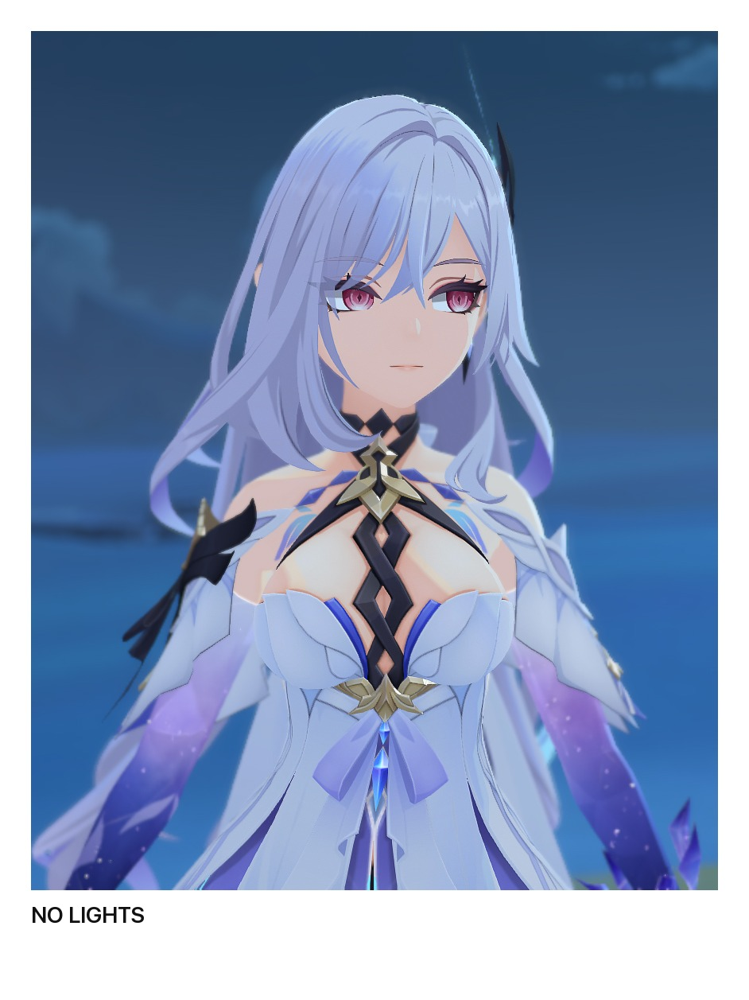
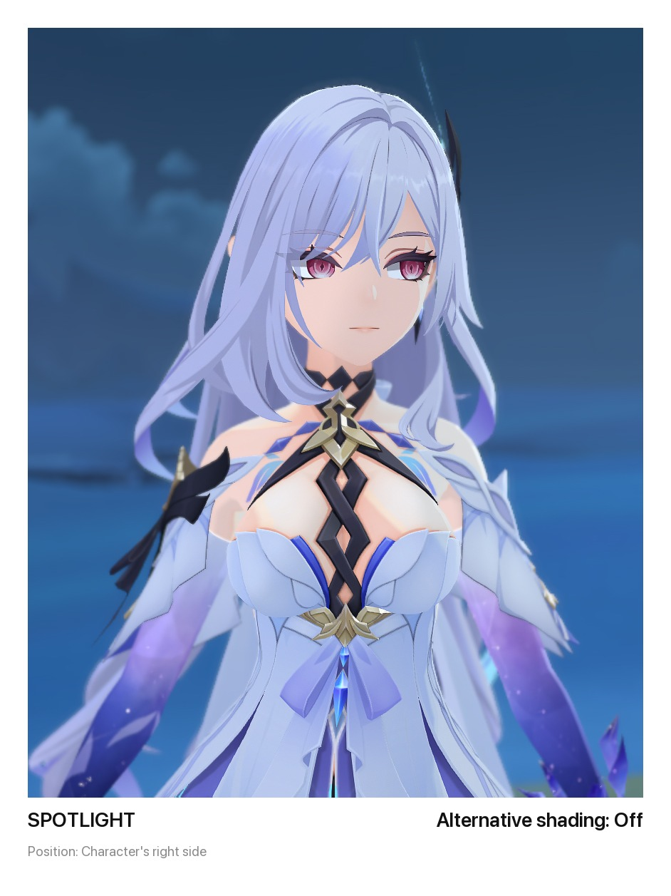
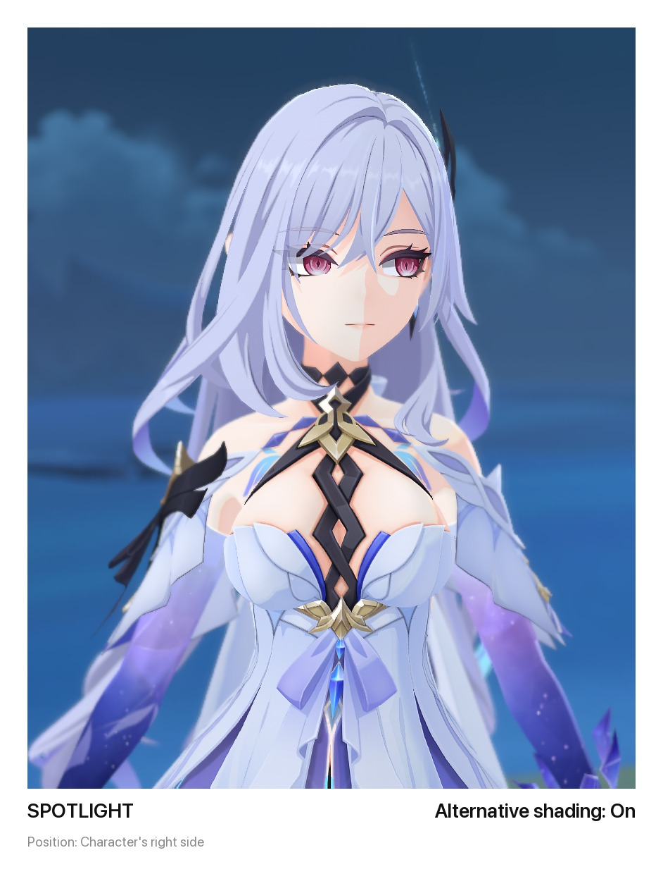

# Lights

The Lights tab adds lights of your own to a shot. Lights show while the free camera is on, and CameraTools saves them, so they are back the next time you play.

## Kinds of light

| Type | What it is |
|--|--|
| Point | A light of the game's own that shines in every direction. It can light everything or only characters, and casts no shadows. |
| Spot | A game light that shines in a cone where it faces, and can cast shadows. |
| Sphere | A soft light with a size, drawn by ReShade's iMMERSE ReLight instead of the game. It casts soft shadows and lights everything around it. |

A light that lights only characters leaves the ground and the scenery as they are, so it works as a key or fill light for portraits. Its intensity stops at 3, because 1 is already a soft fill and 3 is very bright. A light of everything also brings a characters-only copy of itself at half its intensity, because the game's world lights reach characters only weakly.

On a character, a point or spot lights the side that faces it, and the light ends in a soft toon edge, as the game's own character lights do.

A spot casts shadows when Shadows is on. Genshin draws shadows of its own lights for spots only, so a point has no Shadows row: for a shadow from a lamp, use a wide spot aimed at the subject, or a sphere. The game's Lowest shadow quality turns spot shadows off, so while a spot with Shadows on shows at Lowest, CameraTools turns Unity's shadows on, and gives the setting back to the game when the spot goes. If the Graphics tab's Shadows row is set to Off, that choice wins and the spots cast no shadows.

A spot closer than about 1 m to the character loses part of the character's shadow along a straight edge, so keep spots at least 1 m away.

The game's lights have no size, so their shadows have hard edges. A sphere has a size: a bigger radius makes it softer, not brighter, and its shadows soft.

## Alternative shading

The game shades its characters with their own copy of the sun. The sun or the moon sets where the face shadow falls, where the shadow edge runs across the body, and the colour of the lit side. Alternative shading hands that copy to a light of yours: the face shadow and the shadow edge follow the light as you move it, and its colour tints the lit side. The sun still lights the world as before.

  
  
  

Only one light can have Alternative shading at a time. On the other lights, the row says which light has it, and turning it on there moves it to that light. It works for points, spots and spheres, and needs no ReShade.

The intensity of the light does not change the brightness of the sun's shading, which stays the game's. For a second colour, such as a warm light on the shadow side of the face, add a second light without Alternative shading on the other side of the character.

## Placing a light

New light places a light 1.5 m in front of the camera, facing where the camera looks. Follow decides what the light moves with:

- Nothing: it stays where it was placed.
- Camera: it moves and turns with the camera.
- Character: it keeps its place beside the active character, and moves and turns with the character.

Move light hides the panel and puts the camera where the light is, facing where it points. You fly the camera with the free camera's own controls, and the light moves with it, so you see what the light sees. A spot's cone shows as a cream ring, with a dashed ring for the inner angle, and the screen outside the cone is darkened. The view widens until the whole cone fits, up to 150°. The bottom left gives the light's settings, its distance from the character and its height above their feet.

While you move it, X and Y narrow and widen a spot (4 and 5 on the keyboard), and the roll buttons dim and brighten the light. A (Enter) keeps the new place and B (Esc) puts the light back. Either way, the camera returns to your shot. A sphere is carried 1.5 m ahead of the camera, because ReLight can't draw it at the lens. A light that follows the camera has no Move light row.

Move in front of camera puts the light 1.5 m in front of the camera again.

Each light has a marker on the screen: a dot of its colour with its number, ringed in cream for the selected light, with a line for a spot's aim. ReLight also draws a see-through ball where a sphere is. Show light markers turns them off. Hide UI hides them, and they are never in a screenshot.

## Colour

Colour from Temperature sets the colour in kelvin, from candle light at 1000 K to an overcast blue at 12000 K. Colour from Hue sets it by hue and saturation. Intensity sets the brightness. Type a colour into Hex as six hex digits, like FFB46B, with the keyboard or with Steam+X on the Deck.

## Spheres and ReShade

Spheres need ReShade with the `CameraToolsReShadeBridge.addon64` add-on, and iMMERSE's `MartysMods_RELIGHT.fx` and `MartysMods_LAUNCHPAD.fx` shaders. ReLight takes its normals from Launchpad. Do not load ReLight's own add-on, `MartysMods_ReLightAddon.addon64`: it writes the same lights as CameraTools, and the two would fight.

While a sphere exists, CameraTools turns ReShade's effects on and runs only ReLight and Launchpad, so your other effects cost no frame rate while you compose. A screenshot turns your own effects back on beside ReLight, and switches them off again after the shot. Your ReShade preset keeps your own choice of effects throughout. When the last sphere goes, or the free camera turns off, everything is put back as it was.

ReLight works on the picture on the screen, so a sphere lights only while its place is in view. Ambient light, in the Spheres section, dims the game's own light below 1, so the spheres take over the scene.
