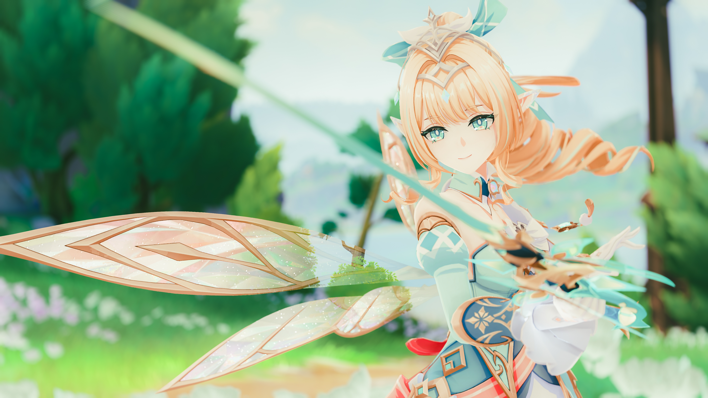
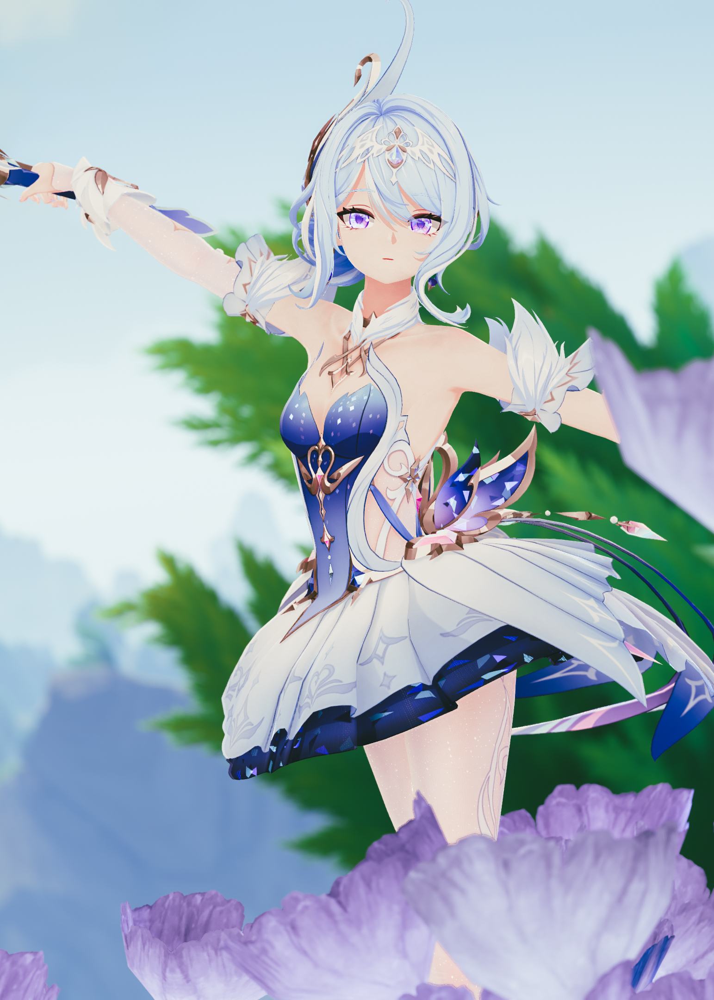
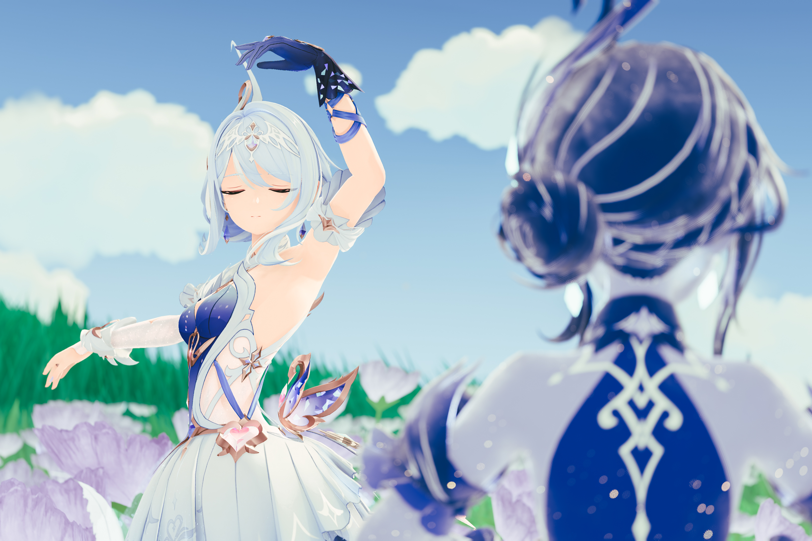
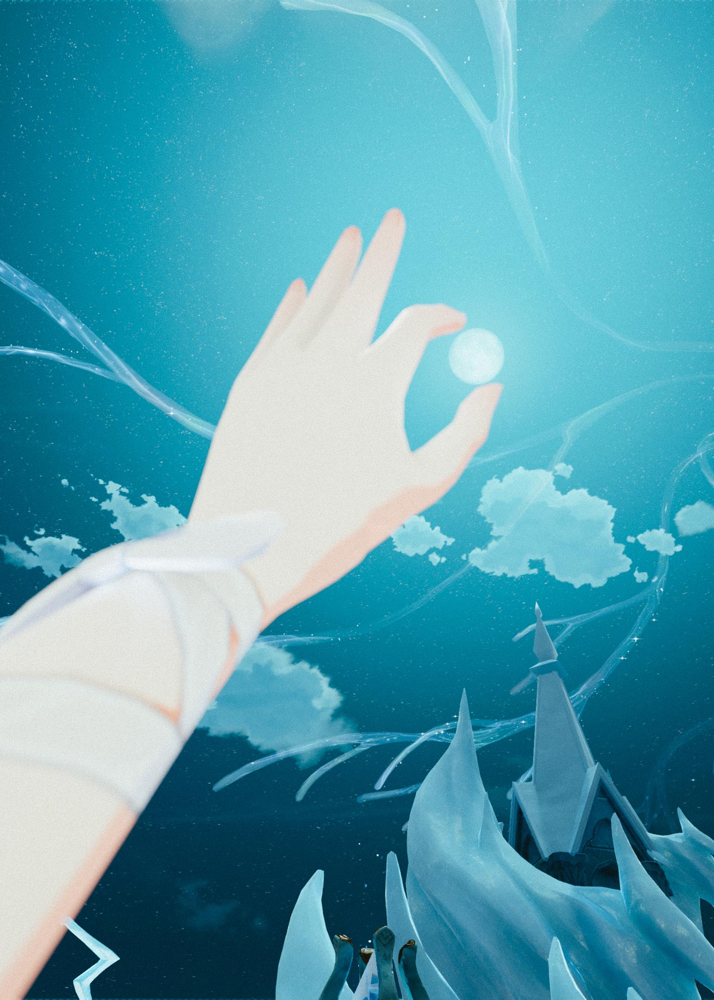
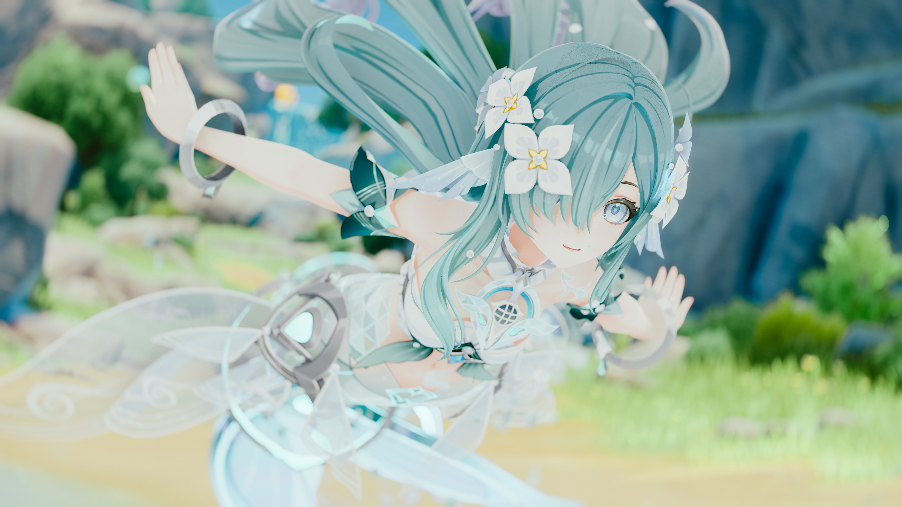
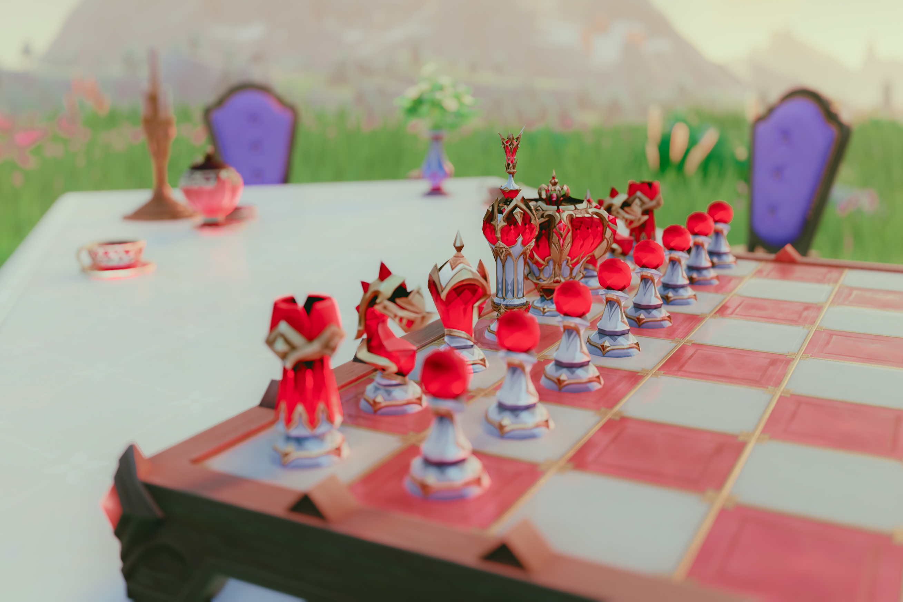

<div align="center">

# Camera Tools

**An advanced photo mode/free camera mod for Genshin Impact**

[Features](#features) · [Showcase](#showcase) · [Getting started](#getting-started) · [Hotkeys](#hotkeys) · [Controller](#controller) · [Graphics](#graphics) · [Building](#building)

</div>

---

## Features

| | |
|--|--|
| **Camera** | Free camera, field of view, roll, smooth movement (damping), near clip |
| **Time** | Pause, slow motion and speed up; time of day with time-lapse; weather override (sunny, cloudy, rain, thunderstorm, snow, mist) |
| **Composition** | Hide UI for clean shots; frame guide for any crop ratio, such as 7:5 or 21:9 |
| **Graphics** | Game settings and resolution from the free camera, with two presets you can make your own |
| **Enhancements** | Ambient light, contact shadows, soft sun shadows, haze, light shafts, wet surfaces and a tone map, through CameraTools' ReShade add-on |
| **Camera paths** | Record views as nodes and fly the camera through them in one shot |
| **Replays** | Record the party, their skills and the enemies near them, and play it back alone or along a camera path to film the moment again |
| **Lights** | Point, spot and soft sphere lights, for the world or only characters |
| **Posing** | Freeze the active character, turn their joints, shape hands and face, save poses |
| **ReShade** | Depth of field with a movable focus point; one-button screenshots at your highest settings, also as long exposures |
| **Input** | Configurable hotkeys; XInput controllers, including the Steam Deck |

## Showcase

### Camera paths

(WIP)

### The mod

(WIP)

### Shot with CameraTools

<table>
<tr>
<td width="50%" valign="top">
  
  
  
</td>
<td width="50%" valign="top">
  
  
  
</td>
</tr>
</table>

## Getting started

1. Press <kbd>F9</kbd> to inject the free camera, then <kbd>Insert</kbd> to turn it on. On a controller, press <kbd>L3</kbd>+<kbd>R3</kbd>.
2. Press <kbd>F10</kbd> (<kbd>Start</kbd>) to open the settings panel. Click and drag with the mouse, or use the controller.
3. Press <kbd>PageDown</kbd> (<kbd>B</kbd>) to hide CameraTools' hints for a clean shot. The free camera already hides the game's HUD.

### Guides

| Guide | What it covers |
|--|--|
| [Camera paths](CAMERA-PATHS.md) | Record camera positions as nodes and fly the free camera through them |
| [Lights](LIGHTS.md) | Add point, spot and sphere lights, aim them with the sticks, attach them to the camera or the character |
| [Pose](POSE.md) | Turn joints, shape hands, set expression and gaze, save poses |
| [ReShade](RESHADE.md) | One-button screenshots, depth of field control, long exposure shots |

## Hotkeys

Rebind any hotkey in `UserData/MelonPreferences.cfg` with a [Unity key code](https://docs.unity3d.com/ScriptReference/KeyCode.html).

<table>
<tr><th>Free camera</th><th>Game speed</th></tr>
<tr valign="top"><td>

| Key | Action |
|--|--|
| <kbd>F9</kbd> | Inject free camera |
| <kbd>Insert</kbd> | Toggle free camera |
| <kbd>I</kbd> <kbd>J</kbd> <kbd>K</kbd> <kbd>L</kbd> | Move |
| <kbd>O</kbd> <kbd>U</kbd> | Move vertically |
| <kbd>,</kbd> <kbd>.</kbd> | Roll left / right |
| <kbd>RShift</kbd> | Reset roll |
| <kbd>;</kbd> | Slow movement (hold) |
| <kbd>RAlt</kbd> | Fast movement (hold) |
| <kbd>8</kbd> <kbd>9</kbd> | Field of view down / up |
| <kbd>0</kbd> | Reset field of view |

</td><td>

| Key | Action |
|--|--|
| <kbd>Delete</kbd> | Toggle pause |
| <kbd>End</kbd> | Reset game speed |
| <kbd>↑</kbd> <kbd>↓</kbd> | Speed +0.1 / −0.1 |
| <kbd>→</kbd> <kbd>←</kbd> | Speed +0.5 / −0.5 |
| <kbd>CapsLock</kbd> | Toggle speed 5.0 |

</td></tr>
<tr><th>Interface</th><th>Camera paths</th></tr>
<tr valign="top"><td>

| Key | Action |
|--|--|
| <kbd>F10</kbd> | Settings panel (free camera only) |
| <kbd>'</kbd> | Focus cursor |
| <kbd>PageDown</kbd> | Hide UI (CameraTools' with the free camera on, the game's HUD with it off) |
| <kbd>]</kbd> | Toggle damage overlay |
| <kbd>[</kbd> | Remove enemy HP overlay |
| <kbd>-</kbd> | Apply resolution slot 1 (1280x800) |
| <kbd>=</kbd> | Apply resolution slot 2 (2560x1600) |

</td><td>

| Key | Action |
|--|--|
| <kbd>Num +</kbd> | Add a node to the selected path (starts one if there is none) |
| <kbd>Num Enter</kbd> | Play or stop the selected path |
| <kbd>Num 1</kbd>–<kbd>9</kbd> | Select path 1 to 9 (during playback, play it from the start) |
| <kbd>Num −</kbd> | Record a replay, or stop recording |
| <kbd>Num *</kbd> | Play or stop the selected replay |

**Depth of field**

| Key | Action |
|--|--|
| Left click | Put the focus point there (cursor free, panel closed) |
| *unbound* | Center the focus point (`CenterFocusPoint`) |

</td></tr>
</table>

## Controller

The game owns the controller until you press <kbd>L3</kbd>+<kbd>R3</kbd>. That hands it to CameraTools: the free camera injects and turns on if needed, the game stops reading the controller, it rumbles, and "Controller: CameraTools" shows at the top of the screen. Press <kbd>L3</kbd>+<kbd>R3</kbd> again to give it back. The free camera stays put, so you can walk the character through a fixed shot.

Hold <kbd>Back</kbd> for the right-hand column. While it is held, <kbd>LT</kbd> and <kbd>RT</kbd> do not move the camera.

| Button | Action | <kbd>Back</kbd> + button |
|--|--|--|
| Left stick | Move (analog) | |
| Right stick | Look around | Move the focus point, while it shows |
| <kbd>LT</kbd> / <kbd>RT</kbd> | Down / up (analog) | Add a path node / play or stop the path |
| <kbd>LB</kbd> / <kbd>RB</kbd> | Roll left / right | Slow / fast movement (hold) |
| <kbd>R3</kbd> | Reset roll | Center the focus point |
| D-pad ↑ / ↓ | Field of view up / down | Speed +0.5 / −0.5 |
| D-pad ← / → | Speed −0.1 / +0.1 | Record or stop a replay / play or stop the replay |
| <kbd>A</kbd> | Toggle free camera | Reset field of view |
| <kbd>B</kbd> | Hide UI | Toggle damage overlay |
| <kbd>X</kbd> | Toggle pause | Remove enemy HP overlay |
| <kbd>Y</kbd> | Reset game speed | Toggle speed 5.0 |
| <kbd>Start</kbd> | Settings panel | Toggle max detail |

While the panel is open, the controller drives the panel instead:

| Button | Settings panel |
|--|--|
| D-pad ↑ / ↓, left stick | Previous / next setting (hold to repeat) |
| D-pad ← / → | Change the value: slider, switch, option, camera path or node, resolution size (hold to repeat) |
| <kbd>A</kbd> | Flip a switch, run an action, apply a resolution slot |
| <kbd>Y</kbd> | Type a resolution slot's size |
| <kbd>LB</kbd> / <kbd>RB</kbd> | Previous / next tab |
| <kbd>B</kbd>, or the panel button (<kbd>Start</kbd>) | Close the panel, or cancel typing |

<kbd>L3</kbd>+<kbd>R3</kbd>, <kbd>Back</kbd> with the right stick, and the panel buttons are fixed. Everything else is rebindable in the `[CameraToolsController]` section, under the hotkeys' names:

- **Buttons**, joined with `+`, such as `Back+A`: `A` `B` `X` `Y` `LB` `RB` `LT` `RT` `Back` `Start` `L3` `R3` `DpadUp` `DpadDown` `DpadLeft` `DpadRight`
- **One analog direction**: `LeftStickUp` `LeftStickDown` `LeftStickLeft` `LeftStickRight` `RightStickUp` `RightStickDown` `RightStickLeft` `RightStickRight` `LT` `RT`

An empty binding does nothing. A binding that does not parse falls back to its default, and the log names it.

## Graphics

The Graphics tab changes the game's graphics settings from the free camera, some past the game's own limits.

### Presets

**Highest** and **Lowest** set every row at once; the line under each row shows what each preset sets it to. **Restore my settings** puts back what you had before CameraTools changed anything.

To make a preset your own, set the rows the way you want (for example, apply Highest and turn Bloom off), then select **Save current settings as Highest** or **as Lowest**. A saved preset sets every game setting, every value past the limits and every enhancement. The screenshot button applies Highest, so in that example your screenshots have no bloom. **Reset presets** brings back the built-in ones.

### Enhancements

This category controls the effects of CameraTools' ReShade add-on, `CameraToolsEnhancements.addon64`. Everything starts off.

- The heading folds the category away and shows how many effects are on.
- The **Enhancements** switch turns all effects on or off; each effect also has its own switch, which reveals its settings.
- **Reset enhancements** puts every switch and value back to its default.
- Changes are saved and applied when the game starts.
- Built-in presets leave enhancements alone. A saved preset sets them too, and Restore puts them back.

If the heading says the add-on was not found, ReShade has not loaded it.

## Frame guide

The Camera tab's Frame guide draws your planned crop as a frame in the middle of the screen. Turn on **Show frame guide** and pick an aspect ratio, or pick **Custom** and type one, such as `7:5` or `2.4`.

- **Portrait** turns the frame on its side.
- **Outside the frame** shades the cut-off area, from lines only at 0% to black at 100%.
- **Rule of thirds** adds a grid inside the frame.

Hide UI hides the guide, and the screenshot button hides it before the shot.

## Configuration

All settings live in `UserData/MelonPreferences.cfg`.

<details>
<summary><b><code>[CameraToolsGraphics]</code></b></summary>

| Entry | Default | Description |
|--|--|--|
| `ResolutionSlot1` | `1280x800` | Size the <kbd>-</kbd> hotkey and Slot 1 apply, as WxH |
| `ResolutionSlot2` | `2560x1600` | Size the <kbd>=</kbd> hotkey and Slot 2 apply, as WxH |
| `HideOutlines` | `false` | Hides outlines around characters, NPCs and weapons. Set by the Outlines switch; presets and screenshots leave it alone. |
| `HighestPreset` | empty | Your own Highest preset. Empty means built-in. |
| `LowestPreset` | empty | Your own Lowest preset. Empty means built-in. |
| `SavedSettings` | empty | Your game settings before CameraTools first changed one, for Restore. Managed by CameraTools. |
| `SavedEnhancements` | empty | Your enhancements before a preset first changed them, for Restore. Managed by CameraTools. |

Slots from 320x200 to 16384x16384 are accepted. A slot that does not parse falls back to its default, and the log names it.

</details>

<details>
<summary><b><code>[CameraToolsEnhancements]</code></b></summary>

One entry per switch and value of the Enhancements category, under the names the log uses, plus `Folded`, which keeps the category folded.

</details>

<details>
<summary><b><code>[CameraToolsFrameGuide]</code></b></summary>

`Shown`, `AspectRatio`, `CustomRatio`, `Portrait`, `OutsideTheFrame` (0 to 1) and `RuleOfThirds`.

</details>

## Building

CameraTools has three parts. The mod checks each add-on's version, so build and install them together:

| Part | File | Needed for |
|--|--|--|
| The mod | `CameraTools.dll` | Everything |
| The ReShade add-on | `CameraToolsReShadeBridge.addon64` | The ReShade tab and sphere lights |
| The Enhancements add-on | `CameraToolsEnhancements.addon64` | The Graphics tab's Enhancements |

### The mod

You need the .NET 6 SDK or newer and a custom MelonLoader install whose `MelonLoader/net6` and `MelonLoader/Il2CppAssemblies` hold the references.

```sh
dotnet build CameraTools -c Release -p:GameDir=<game folder>
```

`GameDir` can also come from the environment. If a reference is missing, the build says which. Copy `CameraTools/bin/Release/CameraTools.dll` to the game's `Mods` folder.

### The ReShade add-on

The source is in `ReShadeBridge/`. You need Python 3 and LLVM's `clang-cl` and `lld-link`. The script downloads ReShade's API headers at the version the add-on targets.

**macOS or Linux**

```sh
brew install llvm lld                              # macOS
xwin --accept-license splat --output <sdk folder>  # Windows SDK and C runtime
python3 ReShadeBridge/build.py --sdk <sdk folder>
```

[xwin](https://github.com/Jake-Shadle/xwin) downloads the Windows SDK and C runtime; `--accept-license` accepts Microsoft's license for them.

**Windows**: install LLVM, open a Visual Studio developer prompt, and run `python ReShadeBridge/build.py`.

The add-on lands in `ReShadeBridge/bin/`. Copy it to the ReShade folder, or the folder `AddonPath` in `ReShade.ini` names. `build.py --help` lists the other options.

The tests play the add-on's request tables against a fake ReShade and need only a C++17 compiler:

```sh
ReShadeBridge/tests/run.sh
```

### The Enhancements add-on

The source is in `Enhancements/`. It builds like the ReShade add-on, with the same LLVM and Windows SDK, and also needs `vkd3d-compiler` from [vkd3d](https://gitlab.winehq.org/wine/vkd3d), Wine's HLSL compiler, to compile its shaders.

```sh
python3 Enhancements/build.py --sdk <sdk folder> --vkd3d-compiler <path to vkd3d-compiler>
```

Instead of `--vkd3d-compiler`, you can set `ENHANCEMENTS_VKD3D_COMPILER`. On Windows, leave out `--sdk` and run from a Visual Studio developer prompt.

The add-on lands in `Enhancements/bin/`. Copy it next to the ReShade add-on. The tests need a C++17 compiler and Python 3 with numpy:

```sh
Enhancements/tests/run.sh
```

## Credits

Free camera script by [FreyaHolmer](https://gist.github.com/FreyaHolmer/650ecd551562352120445513efa1d952).
