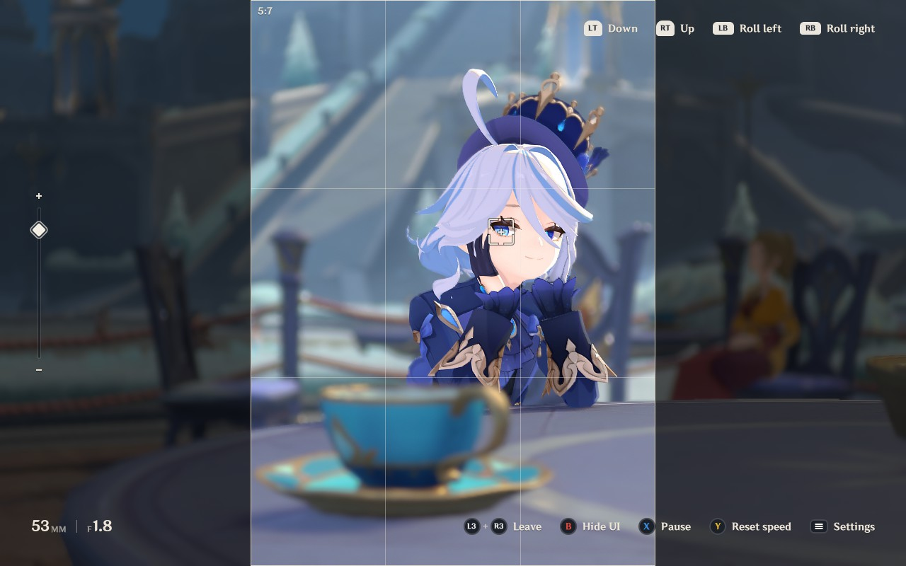
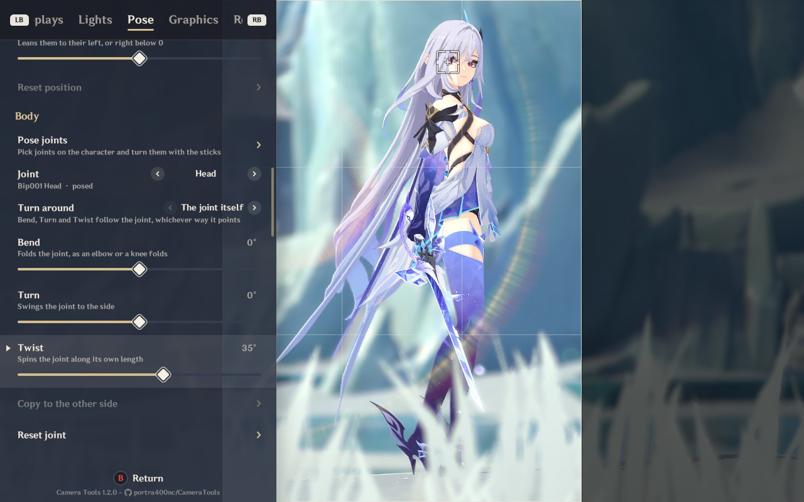
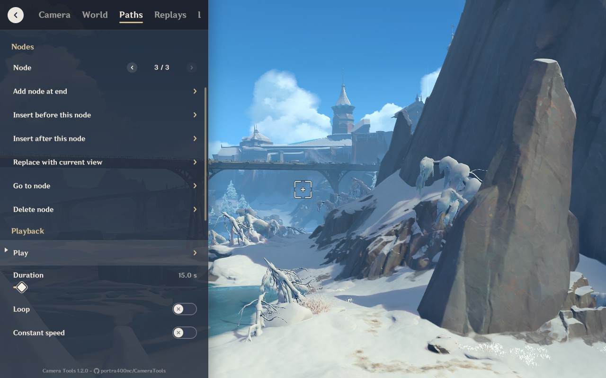
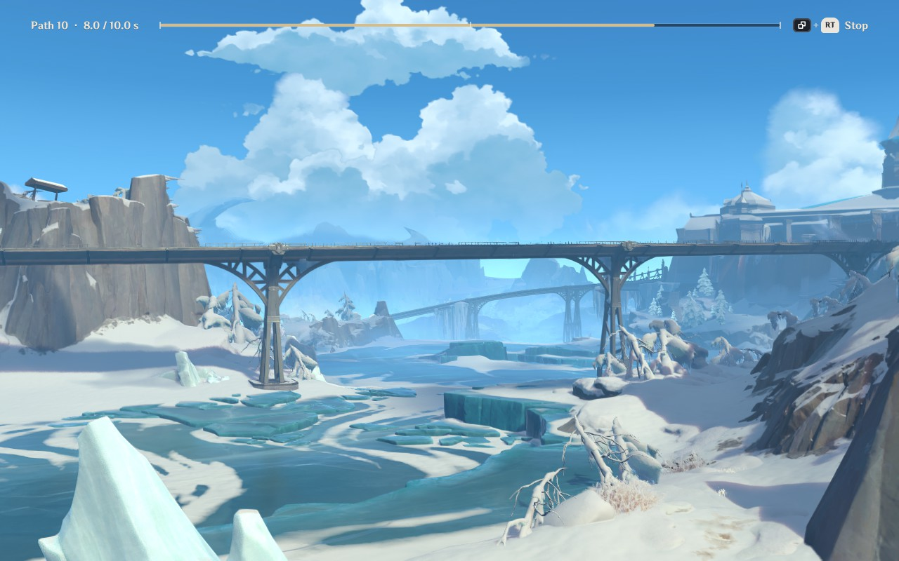
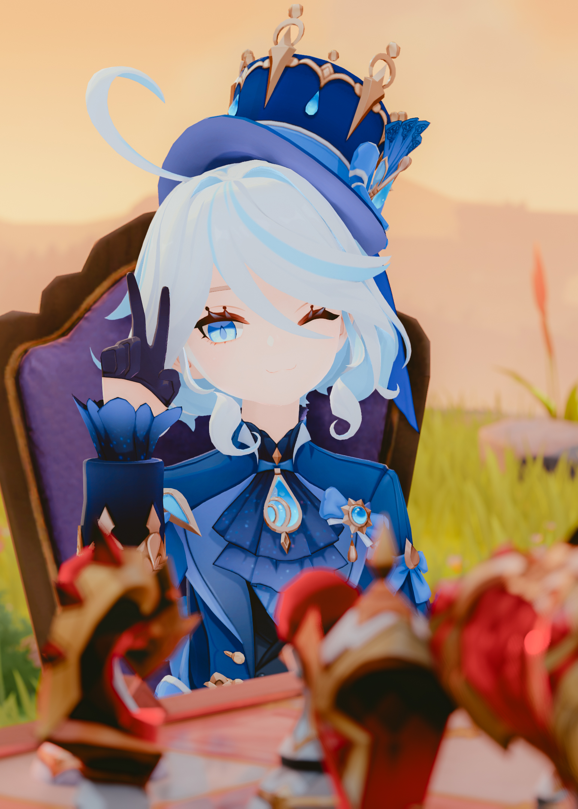

<div align="center">

# Camera Tools

**An advanced photo mode/free camera mod for Genshin Impact**

[Features](#features) · [Showcase](#showcase) · [Installation](#installation) · [Getting started](#getting-started) · [Hotkeys](#hotkeys) · [Controller](#controller) · [Graphics](#graphics) · [Building](#building)

</div>

---

## Features

| | |
|--|--|
| **Camera** | Free camera, focal length, roll, smooth movement (damping), near clip |
| **Time** | Pause, slow motion and speed up; time of day with time-lapse; weather override (sunny, cloudy, rain, thunderstorm, snow, mist) |
| **Composition** | Hide UI for clean shots; frame guide for any crop ratio, such as 7:5 or 21:9 |
| **Graphics** | Game settings and resolution from the free camera, with two presets you can make your own |
| **Enhancements** | Ambient light, contact shadows, soft sun shadows, haze, light shafts, wet surfaces, a tone map and a vintage lens flare, through CameraTools' ReShade add-on |
| **Camera paths** | Record views as nodes and fly the camera through them in one shot |
| **Replays** | Record the party, their skills and the enemies near them, and play it back alone or along a camera path to film the moment again |
| **Lights** | Point, spot and soft sphere lights, for the world or only characters |
| **Posing** | Freeze the active character, move and turn them, turn their joints, shape hands and face, save poses |
| **Depth of field** | A real lens's blur inside the game, from the focal length, aperture and focus distance: autofocus on a point or on the character's eyes, bokeh with blades, soap-bubble rims, chromatic fringes, cat's eye and swirl, through CameraTools' Enhancements add-on. Cinematic DOF and iMMERSE work too. |
| **ReShade** | One-button screenshots at your highest settings, also as long exposures and as DNG raw files for Lightroom |
| **Input** | Hotkeys you change in the panel; XInput controllers, including the Steam Deck |

## Showcase

### Camera paths

https://github.com/user-attachments/assets/e898ae54-dfb5-4270-bfce-81479329b2ad

### The mod

<table>
<tr>
<td width="50%" valign="top">
  
  <p align="center"><sub>Free camera with a frame guide</sub></p>
</td>
<td width="50%" valign="top">
  
  <p align="center"><sub>Posing a character's joints</sub></p>
</td>
</tr>
<tr>
<td width="50%" valign="top">
  
  <p align="center"><sub>Building a camera path</sub></p>
</td>
<td width="50%" valign="top">
  
  <p align="center"><sub>Playing the path back</sub></p>
</td>
</tr>
</table>

### Shot with CameraTools

<table>
<tr>
<td width="50%" valign="top">
  
  
  
</td>
<td width="50%" valign="top">
  
  
  
</td>
</tr>
</table>

## Installation

This mod requires a [custom build of MelonLoader](https://github.com/portra400nc/melon/releases) that supports Genshin. [ReShade](https://reshade.me) with full add-on support is optional: without it, the Enhancements, depth of field, ReShade tab and sphere lights are unavailable.

1. Download the latest release from the [Releases](https://github.com/portra400nc/CameraTools/releases) page.
2. Copy `CameraTools.dll` into MelonLoader's `Mods` folder.
3. Optional, with ReShade: copy `CameraToolsReShadeBridge.addon64` and `CameraToolsEnhancements.addon64` into the folder ReShade loads add-ons from: `reshade-shaders/Addons`, or the folder that `AddonPath` in `ReShade.ini` names.
4. Start the game, load into the world, and press <kbd>Insert</kbd> or <kbd>L3</kbd>+<kbd>R3</kbd>. See [Getting started](#getting-started).

Take all three files from the same release. CameraTools checks each add-on's version, and if one does not match, the tab that needs it says which version it found and which it needs. Without ReShade and the add-ons, the free camera, paths, replays, lights and posing still work.

To update, replace the files with the ones from the new release. To uninstall, delete them. Your settings stay in `UserData/MelonPreferences.cfg`, and your camera paths, lights and poses in `UserData/CameraTools/`.

## Getting started

1. Press <kbd>Insert</kbd> to turn on the free camera. On a controller, press <kbd>L3</kbd>+<kbd>R3</kbd>. Press it again to leave.
2. Press <kbd>Tab</kbd> (<kbd>Start</kbd>) to open the settings panel. Click and drag with the mouse, or use the controller.
3. Press <kbd>H</kbd> (<kbd>B</kbd>) to hide CameraTools' hints for a clean shot. The free camera already hides the game's HUD.

While the free camera is on, the game ignores the keyboard, mouse and controller, so <kbd>W</kbd> moves only the camera. While it is off, the game has them back, and only <kbd>Insert</kbd> and <kbd>L3</kbd>+<kbd>R3</kbd> reach CameraTools.

### Guides

| Guide | What it covers |
|--|--|
| [Camera paths](CAMERA-PATHS.md) | Record camera positions as nodes and fly the free camera through them |
| [Lights](LIGHTS.md) | Add point, spot and sphere lights, place them by looking through them, attach them to the camera or the character, and shade characters from a light as from the sun |
| [Pose](POSE.md) | Move the character, turn joints, shape hands, set expression and gaze, save poses |
| [ReShade](RESHADE.md) | Depth of field, one-button screenshots, long exposure shots, DNG raw files |

## Hotkeys

To change a hotkey, open the panel's **Keybinds** tab and click the key or the controller binding, then press the new key or buttons. On the controller, select the row and press <kbd>A</kbd>. A combination such as <kbd>Back</kbd>+<kbd>X</kbd> counts when you let go of the last button.

- <kbd>Esc</kbd> cancels and <kbd>Backspace</kbd> clears the key. A controller rebind gives up after 5 seconds with nothing pressed.
- A key that another hotkey uses swaps: that hotkey takes the old key, and a notice says so.
- **Restore defaults**, at the top of the tab, puts every hotkey back. Press it twice.
- Toggle free camera always keeps a key and a controller binding, so you can always leave the free camera. <kbd>Enter</kbd> cannot be bound, because Move light, Pose joints, Move character and Edit replay use it.

The bindings are saved in `UserData/MelonPreferences.cfg`, under the hotkeys' names: keys in `[CameraTools]` as [Unity key codes](https://docs.unity3d.com/ScriptReference/KeyCode.html), and controller bindings in `[CameraToolsController]`.

<table>
<tr><th>Free camera</th><th>Game speed</th></tr>
<tr valign="top"><td>

| Key | Action |
|--|--|
| <kbd>Insert</kbd> | Toggle free camera |
| <kbd>W</kbd> <kbd>A</kbd> <kbd>S</kbd> <kbd>D</kbd> | Move |
| <kbd>Space</kbd> <kbd>Ctrl</kbd> | Move up / down |
| <kbd>Q</kbd> <kbd>E</kbd> | Roll left / right |
| <kbd>Right Shift</kbd> | Reset roll |
| <kbd>Shift</kbd> | Fast movement (hold) |
| <kbd>Alt</kbd> | Slow movement (hold) |
| <kbd>1</kbd> <kbd>2</kbd> | Zoom out / in |
| <kbd>3</kbd> | Reset zoom |

</td><td>

| Key | Action |
|--|--|
| <kbd>Z</kbd> | Toggle pause |
| <kbd>X</kbd> | Reset game speed |
| <kbd>↑</kbd> <kbd>↓</kbd> | Speed +0.1 / −0.1 |
| <kbd>→</kbd> <kbd>←</kbd> | Speed +0.5 / −0.5 |
| <kbd>Caps Lock</kbd> | Toggle speed 5.0 |

</td></tr>
<tr><th>Interface</th><th>Camera paths and replays</th></tr>
<tr valign="top"><td>

| Key | Action |
|--|--|
| <kbd>Tab</kbd> | Settings panel |
| <kbd>R</kbd> | Free the cursor |
| <kbd>H</kbd> | Hide UI |
| <kbd>-</kbd> | Apply resolution slot 1 (1280x800) |
| <kbd>=</kbd> | Apply resolution slot 2 (2560x1600) |

</td><td>

| Key | Action |
|--|--|
| <kbd>Num +</kbd> | Add a node to the selected path (starts one if there is none) |
| <kbd>Num Enter</kbd> | Play or stop the selected path |
| <kbd>Num 1</kbd>–<kbd>9</kbd> | Select path 1 to 9 (during playback, play it from the start) |
| <kbd>Num −</kbd> | Record a replay |
| <kbd>Num *</kbd> | Play or stop the selected replay |
| <kbd>Esc</kbd> | Stop a path or a replay while it plays |

**Depth of field**

| Key | Action |
|--|--|
| Left click | Put the focus point there (cursor free, panel closed or beside it) |
| *unbound* | Center the focus point |

</td></tr>
</table>

<kbd>Esc</kbd> and the left click are fixed. Every other key above is a default you can change.

## Controller

<kbd>L3</kbd>+<kbd>R3</kbd> turns the free camera on, and with it hands the controller to CameraTools: the game stops reading it and it rumbles. Press <kbd>L3</kbd>+<kbd>R3</kbd> again to leave the free camera and give the controller back.

Recording a replay gives the controller to the game and turns the free camera off, so you play as usual while it records. With **Play camera path while recording** on, the free camera stays on and flies the path instead. Press <kbd>L3</kbd>+<kbd>R3</kbd> (<kbd>Insert</kbd>) to stop the recording and return to the free camera.

Hold <kbd>Back</kbd> for the right-hand column. While it is held, <kbd>LT</kbd> and <kbd>RT</kbd> do not move the camera.

| Button | Action | <kbd>Back</kbd> + button |
|--|--|--|
| Left stick | Move (analog) | |
| Right stick | Look around | Move the focus point, while it shows |
| <kbd>LT</kbd> / <kbd>RT</kbd> | Down / up (analog) | Add a path node / play or stop the path |
| <kbd>LB</kbd> / <kbd>RB</kbd> | Roll left / right | Slow / fast movement (hold) |
| <kbd>R3</kbd> | Reset roll | Center the focus point |
| D-pad ↑ / ↓ | Zoom in / out | Speed +0.5 / −0.5 |
| D-pad ← / → | Speed −0.1 / +0.1 | Record a replay / play or stop the replay |
| <kbd>A</kbd> | | Reset zoom |
| <kbd>B</kbd> | Hide UI | |
| <kbd>X</kbd> | Toggle pause | |
| <kbd>Y</kbd> | Reset game speed | Toggle speed 5.0 |
| <kbd>Start</kbd> | Settings panel | |

While the panel is open, the controller drives the panel instead:

| Button | Settings panel |
|--|--|
| D-pad ↑ / ↓, left stick | Previous / next setting (hold to repeat) |
| D-pad ← / → | Change the value: slider, switch, option, camera path or node, resolution size (hold to repeat) |
| <kbd>A</kbd> | Flip a switch, run an action, apply a resolution slot, rebind a hotkey |
| <kbd>Y</kbd> | Type a resolution slot's size |
| <kbd>LB</kbd> / <kbd>RB</kbd> | Previous / next tab |
| <kbd>B</kbd>, or the panel button (<kbd>Start</kbd>) | Close the panel, or cancel typing |

<kbd>Back</kbd> with the right stick and the panel's buttons are fixed. Change the others in the Keybinds tab. The right stick always looks around, so it cannot be bound.

## Graphics

The Graphics tab changes the game's graphics settings from the free camera, some past the game's own limits.

### Presets

**Highest** and **Lowest** set every row at once; the line under each row shows what each preset sets it to. **Restore my settings** puts back what you had before CameraTools changed anything.

To make a preset your own, set the rows the way you want (for example, apply Highest and turn Bloom off), then select **Save current settings as Highest** or **as Lowest**. A saved preset sets every game setting, every value past the limits and every enhancement but the depth of field. The screenshot button applies Highest, so in that example your screenshots have no bloom. **Reset presets** brings back the built-in ones.

### Enhancements

This category controls the effects of CameraTools' ReShade add-on, `CameraToolsEnhancements.addon64`. Everything starts off.

- The heading folds the category away and shows how many effects are on.
- The **Enhancements** switch turns all effects on or off; each effect also has its own switch, which reveals its settings.
- **Reset enhancements** puts every switch and value back to its default.
- Changes are saved and applied when the game starts.
- Built-in presets leave enhancements alone. A saved preset sets them too, and Restore puts them back.

If the heading says the add-on was not found, ReShade has not loaded it.

### Lens flare

**Lens flare** draws the flare of an old single-coated lens: thin orange-red arcs with a faint rainbow along them, filled arcs with a thick rim, soft ghost discs with a bright spot, diagonal streaks and a warm glare toward the light. It needs the **Enhancements** switch on.

| Row | Does |
|--|--|
| **Source** | **Sun** follows the sun disc the sky draws and fades while trees, buildings or characters hide it, on the picture or off it. **Manual** places a light that is never hidden. |
| **Position X**, **Position Y** | Manual only. -1 is the left or top edge and 1 the right or bottom edge; up to 2 places the light past the edge, where most arcs and streaks show. |
| **Strength** | Scales the whole flare. |
| **Arcs**, **Filled arcs**, **Ghosts**, **Streaks**, **Glare** | Each part's brightness. Glare and Filled arcs start at 0.5, the others at 1. |
| **Rainbow** | A band of spectral color along each arc, violet inside and red outside. 1, the default, is a faint fringe; 4 is a full rainbow ring. |
| **Size** | Scales every part. |
| **Warmth** | 0 is cool, 0.5 the lens's own orange, 1 a deeper orange. |
| **Red fringe** | The red edge outside each arc and ghost. |
| **Texture** | The marks a real lens leaves: fine streaks and uneven light along the arcs, dust in the ghosts and faint rays in the glare. 0 is smooth, 1 the default, 2 rough. |

While you compose, the flare is drawn into the picture before the game's HUD and the CameraTools panel, so neither is covered. The screenshot button draws it after ReShade's effects and the depth of field, so no effect blurs it. The game's own sun flare is off while this one runs.

## Frame guide

The Camera tab's Frame guide draws your planned crop as a frame in the middle of the screen. Turn on **Show frame guide** and pick an aspect ratio, or pick **Custom** and type one, such as `7:5` or `2.4`.

- **Portrait** turns the frame on its side.
- **Outside the frame** shades the cut-off area, from lines only at 0% to black at 100%.
- **Rule of thirds** adds a grid inside the frame.

Hide UI hides the guide, and the screenshot button hides it before the shot.

## Configuration

All settings live in `UserData/MelonPreferences.cfg`.

<details>
<summary><b><code>[CameraToolsGraphics]</code></b></summary>

| Entry | Default | Description |
|--|--|--|
| `ResolutionSlot1` | `1280x800` | Size the <kbd>-</kbd> hotkey and Slot 1 apply, as WxH |
| `ResolutionSlot2` | `2560x1600` | Size the <kbd>=</kbd> hotkey and Slot 2 apply, as WxH |
| `HideOutlines` | `false` | Hides outlines around characters, NPCs and weapons. Set by the Outlines switch; presets and screenshots leave it alone. |
| `HighestPreset` | empty | Your own Highest preset. Empty means built-in. |
| `LowestPreset` | empty | Your own Lowest preset. Empty means built-in. |
| `SavedSettings` | empty | Your game settings before CameraTools first changed one, for Restore. Managed by CameraTools. |
| `SavedEnhancements` | empty | Your enhancements before a preset first changed them, for Restore. Managed by CameraTools. |

Slots from 320x200 to 16384x16384 are accepted. A slot that does not parse falls back to its default, and the log names it.

</details>

<details>
<summary><b><code>[CameraToolsEnhancements]</code></b></summary>

One entry per switch and value of the Enhancements category, under the names the log uses, plus `Folded`, which keeps the category folded.

</details>

<details>
<summary><b><code>[CameraToolsFrameGuide]</code></b></summary>

`Shown`, `AspectRatio`, `CustomRatio`, `Portrait`, `OutsideTheFrame` (0 to 1) and `RuleOfThirds`.

</details>

## Building

CameraTools has three parts. The mod checks each add-on's version, so build and install them together:

| Part | File | Needed for |
|--|--|--|
| The mod | `CameraTools.dll` | Everything |
| The ReShade add-on | `CameraToolsReShadeBridge.addon64` | The ReShade tab and sphere lights |
| The Enhancements add-on | `CameraToolsEnhancements.addon64` | The Graphics tab's Enhancements, long exposures and DNG files |

### The mod

You need the .NET 6 SDK or newer and a custom MelonLoader install whose `MelonLoader/net6` and `MelonLoader/Il2CppAssemblies` hold the references.

```sh
dotnet build CameraTools -c Release -p:GameDir=<game folder>
```

`GameDir` can also come from the environment. If a reference is missing, the build says which. Copy `CameraTools/bin/Release/CameraTools.dll` to the game's `Mods` folder.

### The ReShade add-on

The source is in `ReShadeBridge/`. You need Python 3 and LLVM's `clang-cl` and `lld-link`. The script downloads ReShade's API headers at the version the add-on targets.

**macOS or Linux**

```sh
brew install llvm lld                              # macOS
xwin --accept-license splat --output <sdk folder>  # Windows SDK and C runtime
python3 ReShadeBridge/build.py --sdk <sdk folder>
```

[xwin](https://github.com/Jake-Shadle/xwin) downloads the Windows SDK and C runtime; `--accept-license` accepts Microsoft's license for them.

**Windows**: install LLVM, open a Visual Studio developer prompt, and run `python ReShadeBridge/build.py`.

The add-on lands in `ReShadeBridge/bin/`. Copy it to the ReShade folder, or the folder `AddonPath` in `ReShade.ini` names. `build.py --help` lists the other options.

The tests play the add-on's request tables against a fake ReShade and need only a C++17 compiler:

```sh
ReShadeBridge/tests/run.sh
```

### The Enhancements add-on

The source is in `Enhancements/`. It builds like the ReShade add-on, with the same LLVM and Windows SDK, and also needs `vkd3d-compiler` from [vkd3d](https://gitlab.winehq.org/wine/vkd3d), Wine's HLSL compiler, to compile its shaders.

```sh
python3 Enhancements/build.py --sdk <sdk folder> --vkd3d-compiler <path to vkd3d-compiler>
```

Instead of `--vkd3d-compiler`, you can set `ENHANCEMENTS_VKD3D_COMPILER`. On Windows, leave out `--sdk` and run from a Visual Studio developer prompt.

The add-on lands in `Enhancements/bin/`. Copy it next to the ReShade add-on. The tests need a C++17 compiler and Python 3 with numpy:

```sh
Enhancements/tests/run.sh
```

## Credits

- FreyaHolmer: [Free camera script](https://gist.github.com/FreyaHolmer/650ecd551562352120445513efa1d952)
- Otis_Inf: Depth of field and [camera paths](https://opm.fransbouma.com/camerapaths.htm) inspiration
- FRAMED. Screenshot Community: [The Photomode Wishlist](https://framedsc.com/the_photomode_wishlist.htm)